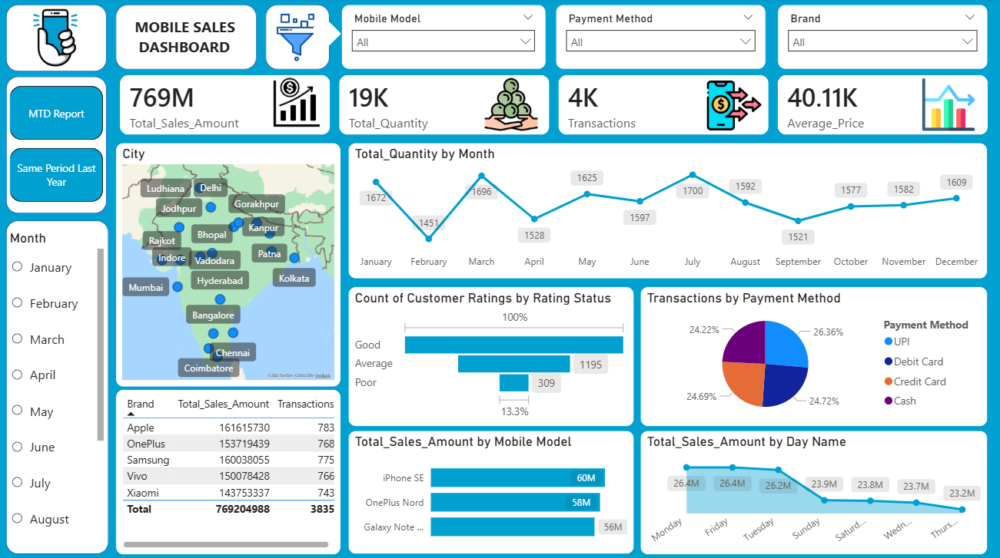
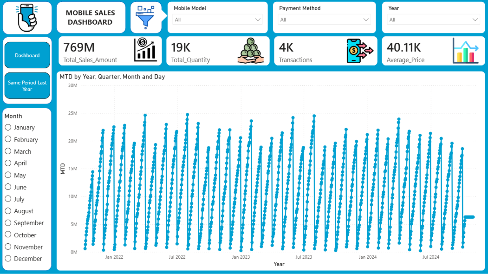
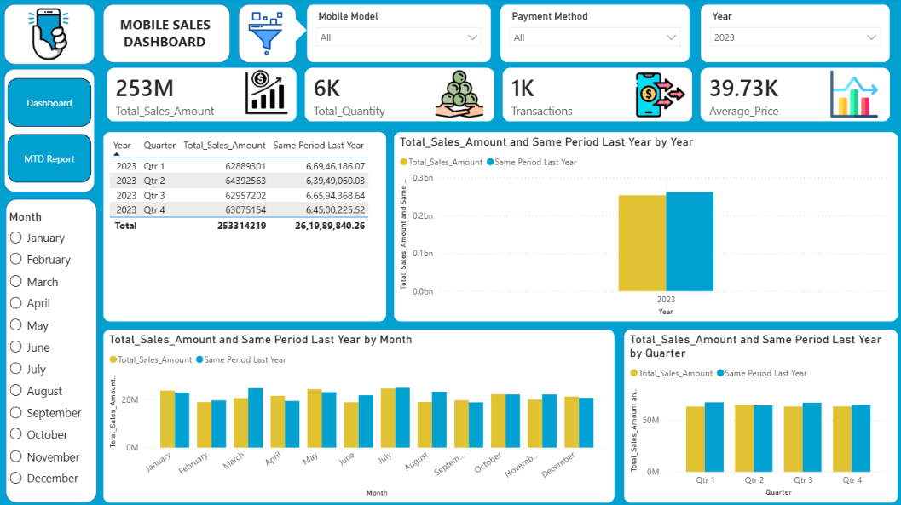

# 📱 Mobile Sales & Regional Performance Dashboard

An end-to-end Power BI commercial analysis project tracking mobile phone sales, regional market trends, revenue growth, and product category performance.

This dashboard delivers granular insights into transactional trends, helping stakeholders identify top-selling models, regional revenue drivers, and seasonal purchasing peaks.

---

## 📥 Deliverables & Quick Access
- 💻 **[Download Power BI Dashboard Model (.pbix)](dashboard/Mobile_Sales_Dashboard.pbix)**
- 📄 **[Download Executive Summary (PDF)](docs/Mobile_Sales_Report.pdf)** *(if applicable)*

---

## 🖥️ Dashboard Preview




---

## 🎯 Key Analytical Features
- **Sales & Revenue KPIs:** Real-time tracking of total revenue, units sold, average order value (AOV), and profit margins.
- **Regional Breakdown:** Geographic performance mapping to isolate high-performing cities and territories.
- **Product Tier Analysis:** Deep dive into smartphone price bands, brand preferences, and feature adoption.

---

## 💡 Key Business Findings
1. **Regional Concentration:** High-tier smartphone sales are heavily concentrated in major metropolitan markets, driving over 60% of total gross revenue.
2. **Seasonality Spikes:** Sales surge significantly during festive seasons and holiday months, heavily influenced by promotional discounts.
3. **Price Sensitivity:** Mid-range mobile models account for the highest volume of units sold, providing a stable baseline for recurring revenue.

---

## 📐 Core DAX Implementations
- **Total Revenue:** Calculated gross sales taking unit volume and dynamic pricing into account.
- **MoM / YoY Growth:** Time-intelligence measures tracking month-over-month and year-over-year revenue trends.
- **Average Order Value (AOV):** Dynamic metric assessing basket size per transaction.

---

## 🚀 How to Run Locally
1. Clone the repository:
   ```bash
   git clone [https://github.com/shubhampandit5002-design/Mobiles-Sales-Dashboard.git](https://github.com/shubhampandit5002-design/Mobiles-Sales-Dashboard.git)